# FayFort system map (study guide)

**Status:** written 2026-10-14 at the end of the products and commerce build (gate P10). It covers every pipeline that
exists in the codebase today and how they connect. Read section 1 first, then one pipeline at a time. Each pipeline lists
what feeds it, what it produces and who uses the result. Section 13 is the dead-weight audit.

## 1. The whole system in one picture

FayFort has three faces and one brain:

- **Member app** (app.fayfort.com/member/chat): a ChatGPT-style chat. Shopping, Find It, orders and giveaways all live inside it.
- **Control Center** (app.fayfort.com): staff and platform admins.
- **Operations Center** (/operations): workers handle sourcing, fulfilment and support work items.
- **The brain**: the FastAPI service on the VPS (api.fayfort.com) with the Supabase database. Outside services: Shopify
  (commerce engine), Resend (email), Hugging Face (the AI model), Cloudflare (tunnel and DNS), Meta (Instagram and Messenger).

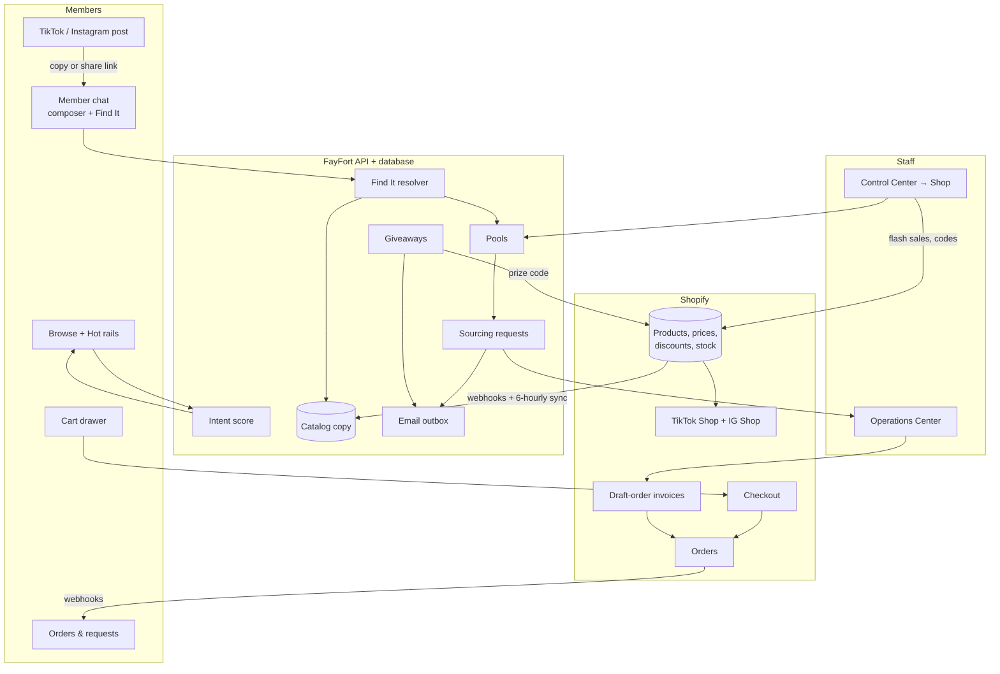

## 2. Accounts and sign-in (auth plan)

**Job:** let members, workers and admins in safely. **Fed by:** Supabase Auth, Turnstile, Resend SMTP.
**Feeds:** every other pipeline (each API call carries the signed-in user).

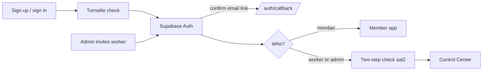

- Members must confirm their email before any member API works (`verified_member`).
- Staff get two-step verification (TOTP); `STAFF_MFA_REQUIRED` enforces it on the server once everyone enrolled.

## 3. Workforce

**Job:** run the team. **Fed by:** admin invitations, presence heartbeats (every 45 s), Supabase audit log.
**Feeds:** assignment of requests and work items; worker directory with online status.

Roles (docs/BOOKINGS_AND_EXECUTIVE_PLAN.md): staff, assistant (runs the CEO's calendar and bookings) and CEO (only one).
Admins add staff from an existing account (search, then an emailed link accepted while signed in at `/staff/join`) or by
email (Supabase invitation); departments chosen at invitation apply when the person becomes active.

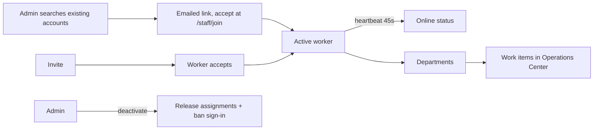

## 4. Sourcing requests (the original FayFort service)

**Job:** find an item the store doesn't stock. **Fed by:** chat request dialog, Find It "Source it", saved/catalog items,
screenshots, recurring schedules. **Feeds:** Operations Center work, member timeline, emails, invoices (new).

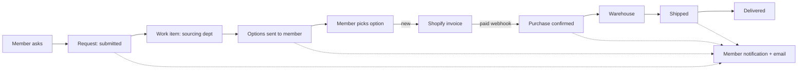

The paid invoice moves the request to "Purchase confirmed" automatically (database function
`record_commerce_invoice_paid`), which fires the existing notification and email. No worker step is needed for payment.

## 5. Email

**Job:** tell members what happened when they're away. **Fed by:** member notifications (request stages, worker replies,
photo reviews, schedules), newsletters, commerce emails (giveaway win, "found it"). **Feeds:** Resend → inboxes.

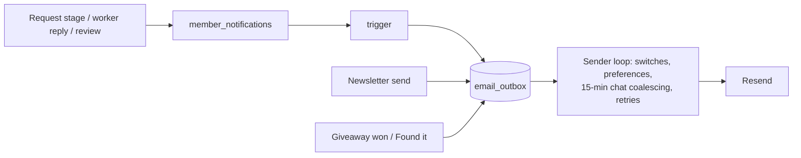

Shopify sends order confirmations, shipping updates and invoice emails itself, so FayFort does **not** send those again.

## 6. Catalog sync (P1)

**Job:** keep a fast local copy of the Shopify catalog. **Fed by:** Shopify product and inventory webhooks, a full
reconcile every 6 hours, "Sync now". **Feeds:** Browse, chat suggestions, Find It, intent, rails, cart, sales.

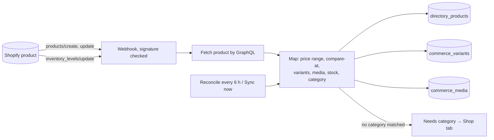

Category matching order: the `fayfort.category_ref` metafield, then product type, then tags. Staff fixes write the
category back to Shopify, so Shopify stays the source of truth.

## 7. Find It (P3)

**Job:** turn a pasted or shared link (or words) into Exact match, Closest alternatives and Source it.
**Fed by:** chat composer (paste, Paste-link button), Android share target (/member/share). **Feeds:** trend items,
intent (paste_link), pools, sourcing requests, staff trend queue.

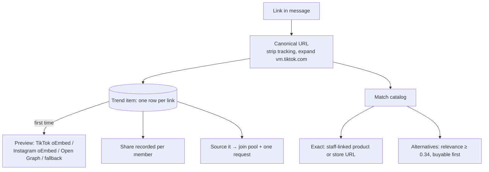

Safety: links are fetched only over HTTPS, only to public addresses (checked on every redirect), at most 512 KB.

## 8. Intent score and Hot rails (P4)

**Job:** decide what to show next. **Fed by:** views, searches, category taps, saves, add-to-cart, pasted links, wants,
paid checkouts. **Feeds:** Picked for you, Browse "For you" sort, Popular, Find It alternatives.

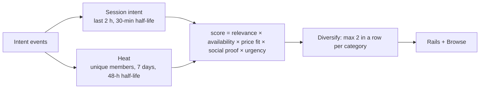

Event weights: pasted link 5, add to cart 4, want 4, save 3, checkout 3, search 2, view 1.5, category 1.
Rails: Picked for you (only with intent), Trending on TikTok & Instagram, Ending soon, Back in stock, Almost sourced,
Under 25, Popular this week (only without intent), plus Giveaways. Empty rails are hidden.

## 9. Pools and invoices (P5)

**Job:** turn shared demand into group buys and get paid. **Fed by:** Source it wants, staff pool settings, chosen
sourcing options. **Feeds:** Shopify draft orders, member "Ready to pay", request stages.

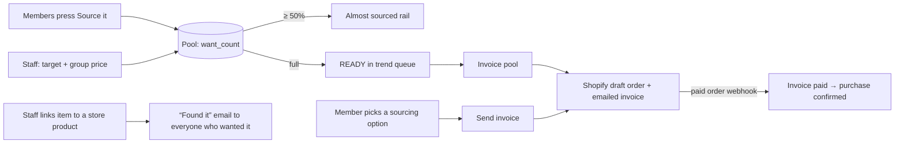

## 10. Cart, checkout and orders (P2, P7/P8)

**Job:** sell. **Fed by:** product panel Add to cart. **Feeds:** Shopify checkout, orders timeline, Heat (checkout events).

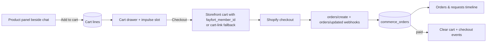

Impulse slots appear only at high-intent moments: after a link is resolved (Get something similar today), after add to cart
(Goes well with), and in the cart (one Ending soon item).

## 11. Flash sales, codes and giveaways (P6, P7)

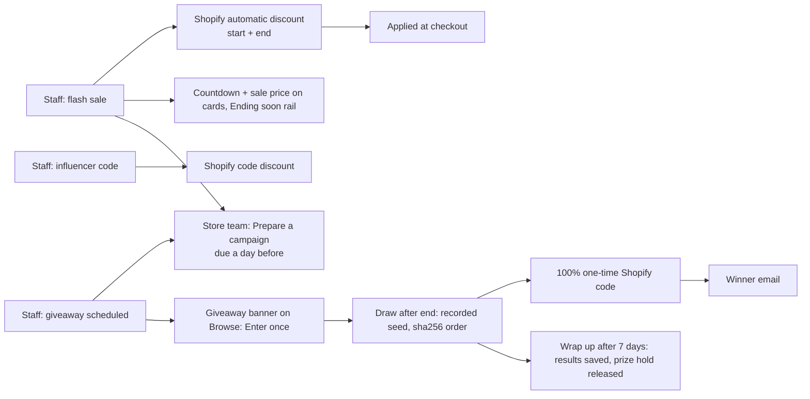

Giveaways are scheduled by default: they open and close by themselves on their dates. A store-product prize is held
back from what members see as available until the giveaway wraps up (a winner still sees it as buyable).

## 11b. Store team, store sections and the Schedule (docs/CATALOG_MERCHANDISING_PLAN.md)

**Job:** keep the shop fresh and every campaign prepared. **Fed by:** workers in the Store team department, the
Shopify catalog sync, Find It trend shares, flash sales and giveaways. **Feeds:** the Shopify catalog (drafts and
publishes), the member catalog (`directory_products`, `commerce_media`), Browse sections, the AI's product facts and
the Schedule.

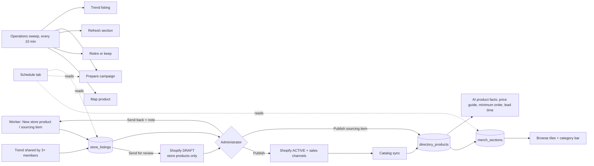

- **Department:** `store_team`, a sixth Operations department. Work types: `list_store_product`, `list_sourcing_item`,
  `map_product`, `retire_listing`, `refresh_section`, `prepare_campaign`. Each has steps, a deadline and a guide.
- **Safety rule:** workers never change what customers see in Shopify. A store product becomes a Shopify DRAFT when
  sent for review; only an administrator's Publish sets it ACTIVE, and only an administrator archives one.
- **Retire rules:** sourcing items with no views or requests for 60 days; store products sold out for 30 days.
  "Keep" needs a reason and snoozes the rule for the same period.
- **Sections:** 3 to 12 live products, a hook, a style and dates. Under its minimum it hides itself and opens a
  refresh task; two days before its end it opens one too. Built-in tiles: Flash sale and New this week.
- **Schedule:** giveaways, sales, sections, launches, deadlines and recurring orders, read from their own tables.
  Workers see the shop calendar plus their own work and open work in their departments; recurring orders are Sourcing's.
- **Tables:** `store_listings`, `merch_sections`, `merch_section_items`, `merch_campaign_preps`; new columns on
  `directory_products` (minimum order, lead time, sold-out date, retire fields) and `commerce_giveaways` (results,
  wrap-up date).

## 12a. Member plans: deposits, consultations, supplier contacts

**Job:** charge for FayFort's expertise by plan (docs/MEMBERSHIP_PLAN.md). **Rules live in one file:**
`app/membership/plans.py`. **Fed by:** `member_profiles.member_tier` (Stripe will set it later), sourcing requests,
paid orders. **Feeds:** Shopify invoices, Operations (consultation chats), the Supplier directory.

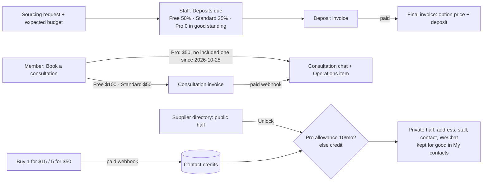

Hotels and restaurants are free. Unlocks run in one database function so a credit can't be spent twice.

**Ranks and points** (`app/membership/ranks.py`):

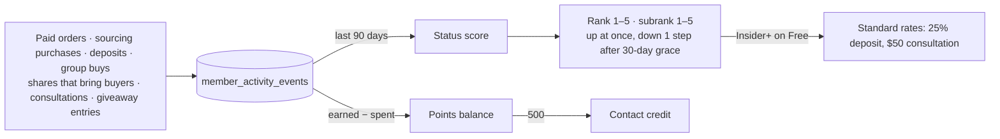

**Plan billing** (`app/billing`, Stripe):

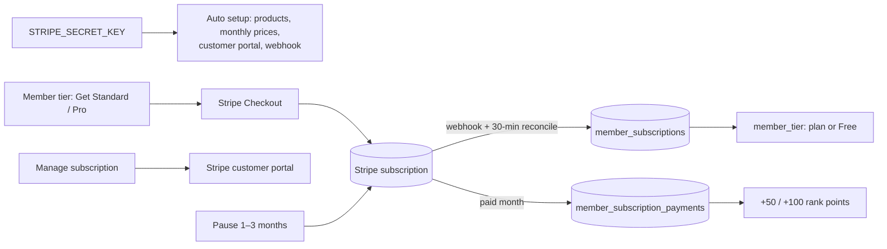

## 12b. Bookings and availability (docs/BOOKINGS_AND_EXECUTIVE_PLAN.md)

**Job:** let members book time with the CEO (consultations), later staff sessions and guides, without double booking.
**Fed by:** weekly hours and blocked time (the assistant keeps the CEO's), member time picks, Shopify payments.
**Feeds:** Operations → Bookings, the Schedule, member support work items, booking emails and reminders.

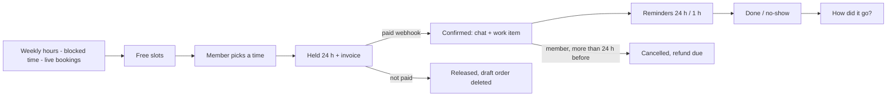

## 12. Social channels (P9)

TikTok Shop and Instagram/Facebook Shop are installed as Shopify sales channels. They read the same Shopify catalog, so
there is no FayFort code for them: a product edited in Shopify updates FayFort (webhook) and the channels (Shopify) at once.
Orders from those channels appear in Shopify (they are not tied to a FayFort member).

## 13. Dead-weight audit

| Item | Finding | Action |
| --- | --- | --- |
| Link field in the sourcing-request dialog | Duplicated Find It | **Removed.** Pasting in the composer replaces it. |
| Separate Requests panel | Duplicated the orders timeline | **Merged** into Orders & requests. |
| Giveaways page in the Control Center menu | Duplicated the Giveaways tab in Shop | **Removed.** Giveaways are run from Control Center → Shop → Giveaways. |
| Order and invoice emails from FayFort | Shopify already sends them | **Not built.** FayFort only emails what Shopify can't (giveaway win, Found it). |
| Manual product editor (Directory & Tools) | Overlaps Shopify for store items | **Kept** for sourcing-only listings; editing Shopify items is blocked there. |
| Checkout records | Stored but unused | **Connected:** Shop overview shows checkouts started vs orders. |
| `/member/products` page and `/members/products` API | Second browse next to Browse in the chat | **Open (C1).** Recommend redirecting the page to the chat's Browse panel; the API stays for saved items and the request dialog. |
| Chat product matching (`_catalog_matches`) | Simple word match beside the intent score | **Open (C2).** Recommend switching it to the intent score so chat and Browse rank the same way. |

Every new table is read by at least one screen: variants/media (product panel), sync runs and webhook events (Shop
overview), cart lines (drawer), intent events (rails, Heat), trend items/shares/pools (Find It, rails, trend queue),
invoices (Ready to pay, Invoices tab, Deposits due), consultations (Member tier pop-up), contact unlocks and credits
(Supplier directory, Member tier pop-up), sales (cards, rails), giveaways/entries/winners (rails, Giveaways tab), orders
(timeline, Orders tab), audit (append-only record of staff actions).
